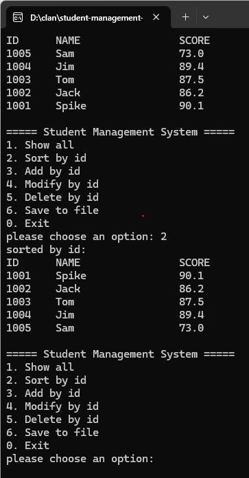

# Student Management System

A console-based student management system written in pure C (C17),
built on a singly linked list with binary file persistence.

## Features

- 7-option menu: add / list all / search by ID / update score / delete / sort by ID / save & exit
- Binary file persistence (`students.dat`) — data survives program restart
- Input validation with `%19s` width limit
- `atexit`-registered cleanup: the linked list is always freed on quit
- Auto-save to `students.dat` when exiting through the menu

## Data Structure

Singly linked list with `malloc`/`free` dynamic memory management:

c
struct Student {
int id;
char name[20];
float score;
struct Student *next;
};

## Build

Requires GCC (MinGW-w64 on Windows). The build must be warning-free
under `-Wall -Wextra`:

bash
gcc -Wall -Wextra -std=c17 -o sms sms.c

## Run

bash
./sms # Linux / Git Bash
sms.exe # Windows console

## Usage

| Option | Action |
|--------|--------|
| 1 | Add a student |
| 2 | List all students |
| 3 | Search by ID |
| 4 | Update score |
| 5 | Delete a student |
| 6 | Sort students by ID |
| 0 | Save to `students.dat` and exit |

## Screenshot

## Project Structure

student-management-system/
sms.c # all source code (single file, C17)
001.png # console screenshot
.gitignore # excludes build artifacts and data file
students.dat # runtime data file (generated, NOT in repo)

## What I Learned

- Pointer manipulation and dynamic memory (`malloc`/`free` pairing)
- File I/O in binary mode (`fwrite`/`fread`)
- Defensive programming: guard clauses and input validation
- Menu loop architecture with `switch` dispatch

## License

This project is released under the MIT License.